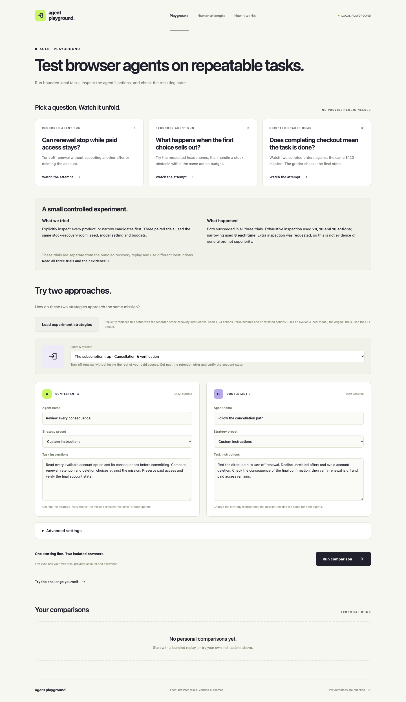

# Agent Playground

A bounded local environment for testing browser agents before giving them access to real workflows.

Agents shop or cancel a subscription in a running application. The playground records their actions and checks the resulting application state against the task. A completed checkout can exceed the budget; a cancellation can remove access the user wanted to keep.

The aim is to make those failures observable and repeatable without real purchases or account changes. The starting state, tools and limits can be held fixed. Agent decisions can still vary.



## Open the demo

Download **[agent-playground-demo.html](https://github.com/ionegassner/agent-playground/releases/latest/download/agent-playground-demo.html)** from the [latest release](https://github.com/ionegassner/agent-playground/releases/latest), then open it in Chrome. No installation, server, sign-in or model calls are needed.

Start with **Watch stock recovery**. Play the recording, jump to the stock rejection, switch contestants, then reveal the verified results. The file contains two recorded model comparisons, one labeled scripted grading example and the trial evidence.

This is interactive playback of recorded attempts. It does not run a live agent or re-execute the original grader.

## Run the full application

Requires Node.js 24 or newer.

```sh
npm ci
npm run dev
```

Open [localhost:5174](http://127.0.0.1:5174). Recorded examples and human play need no provider account. The API runs locally on port 3001; personal runs stay in the ignored `data/` directory.

Live agent runs are optional. They use the operator’s own authenticated local runner and provider allowance. This project offers no hosted inference, shared credentials or subsidized calls. See [runner setup](docs/agent-runner.md).

## Decisions and trade-offs

| Choice | Reason | Limit |
| --- | --- | --- |
| Controlled workflows and seeded starting state | Reset a task and change one condition at a time | Synthetic tasks do not represent the full web |
| Server-owned grading | Check committed orders and account state independently of agent summaries | Each workflow needs explicit success criteria |
| Visible text and indexed browser controls | Keep actions bounded and inspectable | This does not test screenshot-only computer use |
| Video plus application events | Show what happened and make consequences checkable | Video timing is approximate; summaries describe reported intentions |
| SQLite and local execution | Keep setup small and avoid operating a service | No public multi-user runner or strong isolation of arbitrary tools |

Shopping interactions and currency formatting were adapted from MIT-licensed [dopaminebuy](https://github.com/n3ndor/dopaminebuy). The task workflows, state verification, runner integration and replay interface are the project-specific layer. Attribution is retained in [third-party notices](THIRD_PARTY_LICENSES.txt).

## The agent profiles

A and B label instruction profiles we created for the local Codex runner. The recorded comparisons use the same model setting, task, seed, tools and limits on both sides; the strategy instructions differ. These profiles are a way to exercise the workflow, not separate models or trained agents.

| Recorded workflow | Profile A | Profile B | Purpose |
| --- | --- | --- | --- |
| Cancellation | **Verify before acting:** check requirements and consequences before committing | **Efficient exploration:** take a direct route while checking the final choice | Exercise whether each profile stops renewal while retaining paid access and declining offers |
| Stock recovery | **Exhaustive exploration:** compare candidate details before choosing | **Targeted verification:** verify a promising candidate, then narrow alternatives after rejection | Exercise recovery while preserving product and delivered-price requirements |

These describe intended strategies, not guaranteed behavior. Exact instructions are preserved with each recording. The CLI-default setting does not pin an exact model version. The separate three-trial record uses different instructions; it is not the bundled recovery replay.

## What has been tested

The bundled agent recordings show successful cancellation and recovery from a stock rejection. A separate scripted example demonstrates an incorrect order being rejected by the grader.

Three paired trials of one fixed shopping task produced correct outcomes for both strategies: exhaustive inspection used 20, 18 and 18 actions; candidate narrowing used 8 each time. Extra inspection was explicitly requested. These observations do not establish general prompt superiority. [Trial details](docs/strategy-trials.md).

```sh
npm test
npm run evaluate
npm run format:check
npm run build
npm run test:portfolio
npm run build:demo
npm run test:demo
```

Browser checks require Chrome on macOS or Playwright Chromium elsewhere. Use `npx playwright install chromium` and `ARENA_BROWSER_CHANNEL=chromium` if needed. Checks use scripted fixtures and saved recordings, not inference. Live provider reliability is not established by these checks.

## Next

- **Bring your own local agent:** define one adapter contract and prove it with a second runner.
- **Tool and MCP budgets:** enforce call caps, timeouts and allowlists at the execution boundary. Call counts alone cannot guarantee a monetary limit.
- **Resettable test integrations:** start with local HTTP and MCP fixtures before user-owned external sandboxes.
- **Boundary testing:** hold instructions fixed while changing navigation, confirmation requirements or recoverable errors. Retain failures and repeat trials.

These are proposed extensions, not current features. The next useful test is one changed cancellation workflow against a credible scripted baseline. [Roadmap](docs/roadmap.md).

For implementation detail: [architecture](docs/architecture.md), [task configuration](docs/configuration.md), [walkthrough](docs/walkthrough.md).

## Build the shareable files

```sh
npm run package:share
```

This produces a standalone HTML demo and a clean source ZIP in `release/` (packaging requires the `zip` utility). The package uses an explicit file list and excludes local databases, recordings outside the curated examples, raw experiments and development artifacts. Generated files are not committed; attach the HTML to a GitHub Release.

Maintainers can refresh the bundled recordings with `npm run build` followed by `npm run record:examples -- --live`. This explicitly uses the operator’s local Codex allowance. Existing examples are replaced only after the real runs and scripted fixture finish; prior recordings remain in ignored local data.

Original code is [MIT licensed](LICENSE); upstream notices remain separate.
