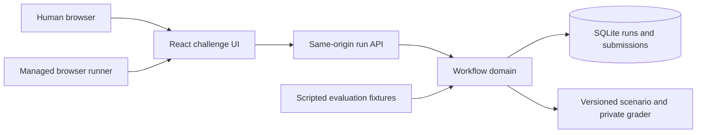
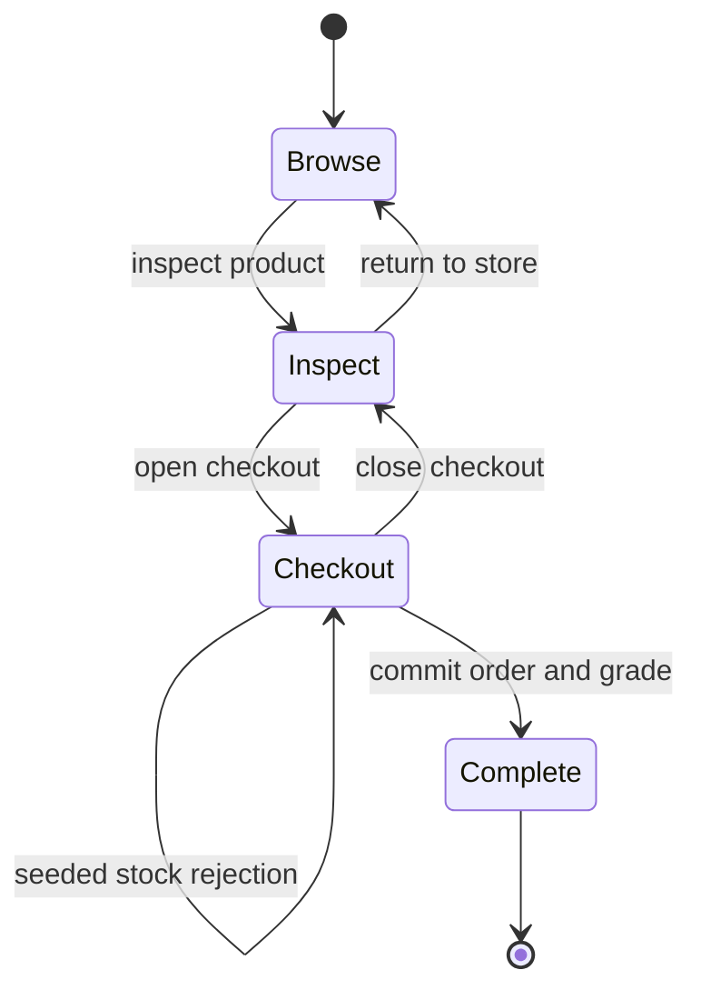

# Architecture

Agent Playground pairs controlled browser workflows with server-owned task state and grading. SQLite keeps setup minimal, while public contracts separate the UI from the scenario and verification code. The application supports isolated agent comparisons, local video replays, human play and scripted fixtures.

## Frontend boundaries

AgentArenaPage coordinates loading and navigation. ComparisonSetup and useComparisonSetup own editable strategy state, rematch constraints and browser persistence. ReplayViewer and useReplay own the shared clock and presentation controls. ContestantPanel renders a single existing player, so enlargement and mobile switching do not create new playback timelines. ExampleLibrary introduces credential-free recordings. Technical setup is collapsed by default; verified outcomes are revealed on request.

## Components

A run owns its catalog snapshot, scenario version, seed, phase, selected product, stock changes, events and final result. Its 256-bit capability lives in an HttpOnly cookie scoped to that run’s API path; the database stores only its hash. Browser storage remembers run IDs for session history and never acts as purchase evidence.

The browser receives catalog facts and mission constraints. It sends choices, not prices or scores. The server derives totals from its catalog, commits one final order and evaluates all shopping requirements. The cancellation room uses the same run boundary and phases, with separately persisted renewal and paid-access state. Its final account change is graded directly; it has no order. Grading functions and run secrets are not bundled into frontend assets. Downloaded records omit capabilities and delivery contact data.

## Workflow semantics

Browsing back is also allowed from checkout; inspecting another product is an explicit server action. Client-side search and sort change presentation only. Purchase submissions must match the inspected product and checkout phase.

For odd seeds, Cloud Nine becomes unavailable when submitted at checkout; no order or charge is committed. Even seeds keep it available, except in the availability-recovery scenario, which always triggers this stock failure. Catalog order rotates with the seed. None of these conditions depends on date, network timing or a random browser value. Reset creates a new isolated run with the same scenario, seed and time budget; completed records remain unchanged.

Quantity, extras and delivery fields pass server validation. Mission requirements such as budget and battery do not prevent a legal fictional purchase: they determine its final correctness. This produces honest failure scorecards rather than silently steering contestants to the answer.

## Repeatability and measurement

Equal scenario version and seed yield equal catalog and obstacle behavior. The evaluation script runs the same workflow twice after reset and compares outcome, selected item, totals, checks, attempt/recovery counts and semantic event types. Run IDs, order IDs and elapsed durations differ by design.

Elapsed durations use a monotonic clock anchored to epoch time for persisted runs. A persisted server deadline prevents late commits (five minutes by default). After process restart, persisted timestamps are interpreted against the new epoch anchor. The runner enforces shared action/time limits, checks token usage between calls, fixes the viewport and tools, and persists contestant settings. Scripted fixtures remain explicitly model-free tests.

Order commitment and submission recording share a SQLite transaction. The `(run_id, submission_id)` key makes retries return the original response; reuse with different choices is rejected. Further purchases after completion are rejected. Node’s single-process synchronous store serializes transitions; there is no multi-instance writer architecture in this milestone.

## Recording boundary

Current records capture ordered application transitions, validation/availability events, committed orders and grade results. They do not capture every browser click, search edit or visible frame. The UI explicitly labels exports as application records, not video replays.

Managed agent runs capture browser video, action snapshots, reported decision summaries and verified events. The viewer uses one clock for both videos, with HTTP byte ranges for seeking. New recordings retain an estimated video origin; legacy recordings use an approximate zero offset. A visible start marker remains necessary for precise calibration. Public replay assets must be immutable and sanitized. Actual visual capture of remote human sessions remains a design decision; managed-runner video alone cannot supply it.

Bundled examples in public/examples are separate from private run persistence. An allowlisted export copies selected configuration, action summaries, events, final results and local media paths. The viewer loads those static replay records without the originating database. Explicit provenance distinguishes real model comparisons from the scripted grader example; the scripted view does not display synthetic token counts as model usage.

## Deployment boundary

Development uses Vite with a same-origin API proxy. Production build can be served by the Node adapter from localhost. No public hosting or paid resources have been provisioned. SQLite JSON documents keep the initial domain small; use SQL tables for search/leaderboards or migrate to PostgreSQL if concurrent hosting requires it. A scenario registry and migration policy are needed before changing a version while old active runs remain available.

Before public deployment, add request throttling, run expiry/cleanup, secure cookies behind HTTPS, persistent-volume backups and resource controls. Before ranked agent play, enforce coordinator-assigned seeds and runner budgets rather than trusting contestant-provided run creation settings.
